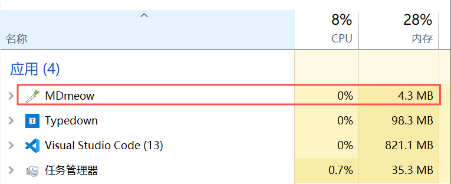

# MDmeow

[简体中文](README.md) · [English](README.en.md) · [日本語](README.ja.md) · **Deutsch**

**Website: [mdmeow.zakee.fun](https://mdmeow.zakee.fun)**

Ein leichter, schneller und angenehm gestalteter WYSIWYG-Markdown-Editor. **Öffnen und sofort arbeiten.**

<a href="https://zakee.fun" target="_blank"></a>


MDmeow ist ein leichter, schneller und angenehm gestalteter WYSIWYG-Markdown-Editor auf Basis von **Tauri + Milkdown/Crepe**. Markdown-Dateien bleiben sauber und portabel, während die Bearbeitung direkt und natürlich bleibt.

Das Standarddesign **Miku Cream** kombiniert einen hellen Dokumenthintergrund, den Akzent `#39C5BB`, dezente Codefarben, KaTeX-Formeln, isolierte HTML-/SVG-/Canvas-Widgets, kompakte Tabellen und eine zurückhaltende Desktop-Oberfläche. Für Typecho-Blogs empfehlen wir die gemeinsame Nutzung mit dem passenden Typecho-Theme **[miku-cream](https://github.com/zakee039/miku-cream)**.

**Schnell geöffnet, angenehm zu lesen, natürlich zu bearbeiten.**

## Hauptfunktionen

- WYSIWYG-Markdown für Überschriften, Listen, Zitate, Aufgaben, Tabellen, Links und Bilder inkl. automatischem Quellschutz (z. B. für YAML-Frontmatter)
- **Sandboxed HTML- / SVG- / Canvas-Widgets**: statische HTML-Karten, `<svg>`-Grafiken und komplexe HTML-Tabellen rendern automatisch in einer skriptfreien Sandbox; interaktive Widgets mit `<script>` oder `<canvas>` laufen erst nach Bestätigung pro Dokument in einer isolierten Offline-Sandbox (`allow-scripts` ohne lokalen Datei- oder Netzwerkzugriff)
- **Verlustfreies natives HTML**: `<details>`/`<summary>`, `<div|p align>`, `<center>`, `<a href>`, `<hr>`, `<kbd>`, `<sub>`, `<sup>`, `<mark>`, `<u>`/`<ins>`, `<small>`, `<ruby>`/`<rt>`/`<rp>`, sichere `<span style>`/`<font color>` sowie ausgeblendete `<!-- ... -->`-Kommentare
- **KaTeX-Formeln**: verlustfreie Unterstützung für `$…$` / `$$…$$` sowie `\(...\)` / `\[...\]` im Editor und beim HTML-/PDF-Export
- **Überschriften-Anker & lokale relative Links**: Klick in der Link-Vorschau oder `Ctrl/Cmd+Klick` springt sanft zu `#anker`, öffnet relative `.md`-Dateien direkt als Tab und sichere lokale Dateien (z. B. `.html`, PDF) in der Standard-App (ausführbare Dateien werden blockiert)
- Mermaid-Diagrammvorschau für `mermaid`-Codeblöcke (Lazy-Loading), ohne den Markdown-Quelltext zu verändern
- Markdown-Quellansicht mit Zeilennummern, Syntaxfarben und dezenten Wechselzeilen
- mehrere Tabs, Sitzungswiederherstellung und einheitliche In-App-Dialoge im Miku-Cream-Stil
- Speichern / Speichern unter, Dateiname direkt im Titelbereich ändern, HTML- / PDF-Export
- Codeblöcke mit Syntaxhervorhebung, Zeilennummern und Kopierfeedback, frei belegbare Tastenkürzel, Windows-Dateizuordnungen
- vier UI-Sprachen: 简体中文, English, 日本語 und Deutsch

## Andere Textdateien schnell ansehen

Auch JSON, YAML, TOML, INI, ENV, HTML, CSS, JavaScript, TypeScript, Python, Rust, Logs und TXT lassen sich direkt öffnen.

Sie erscheinen im leichten **Code-Modus** mit Zeilennummern, Syntaxfarben, Suchen / Ersetzen, Speichern und konfigurierbarer alternierender Zeilenfarbe.

Das ist für schnelle Kontrolle und kleine Änderungen gedacht, nicht als Ersatz für eine vollständige IDE.

## Downloads

```text
Windows
MDmeow-<version>.exe
MDmeow_<version>_x64.msi

Linux x64 / ARM64
AppImage / deb / rpm

macOS
MDmeow-<version>-macOS-universal.dmg
```

Windows bietet Portable EXE und MSI. Linux erhält AppImage / deb / rpm. Für macOS gibt es ein universelles DMG für Intel und Apple Silicon.

## Markdown, HTML und Mathematik

Standard-Markdown steht im Vordergrund. Markdown-Bilder, gängige HTML-``-Formen, `<details>`, `<ruby>`, `<kbd>`, statische `<svg>`-Diagramme und isolierte interaktive HTML-/Canvas-Widgets werden verlustfrei dargestellt. Bilder können ausgerichtet, von 25% bis 200% skaliert und gelöscht werden.

KaTeX rendert Inline- und Blockformeln mit `$`/`$$` sowie `\(...\)`/`\[...\]` unter Beibehaltung der Original-Begrenzer:

```text
$E = mc^2$    /    \( E = mc^2 \)

$$
\int_a^b f(x)\,dx
$$

\[
\operatorname{softmax}([0,\ln2,\ln3])=\left[\frac16,\frac26,\frac36\right]
\]
```

## Miku Cream & passendes Typecho-Theme

- heller Cream-Hintergrund und Akzent `#39C5BB`
- gemeinsame semantische Codefarben für Markdown-Codeblöcke und Code-Modus, Wechselzeilen standardmäßig `#FAFFFF`
- getrennte Schriftarten und Größen für Dokument und Quelle
- einheitliche abgerundete Dialoge und kontrastreiche Tabellen-/Toolbar-Symbole

> **Empfehlung für Typecho-Nutzer: [miku-cream](https://github.com/zakee039/miku-cream)**
>
> Wenn du einen Typecho-Blog betreibst, empfehlen wir die gleichzeitige Nutzung des passenden Typecho-Themes **[miku-cream](https://github.com/zakee039/miku-cream)**. Beide teilen dasselbe Miku-Cream-Design, Codeblöcke, KaTeX-Formeln (`$...$`, `$$...$$`, `\(...\)`, `\[...\]`) sowie die isolierte Darstellung interaktiver HTML-/SVG-/Canvas-Widgets.

## Dateien und Fenster

- Drag & Drop
- mehrere Tabs
- optional vollständiger Dateipfad
- optionale Sitzungswiederherstellung
- Fensterposition und -größe können gespeichert werden
- ohne Positionsspeicherung startet MDmeow sinnvoll zentriert auf dem Hauptbildschirm
- Windows-Dateizuordnungen nach Erweiterung
- Einstellungen werden sofort gespeichert

## Tastenkürzel

| Aktion | Standard |
| --- | --- |
| Neuer Tab | `Ctrl/Cmd+N` |
| Öffnen | `Ctrl/Cmd+O` |
| Speichern | `Ctrl/Cmd+S` |
| Speichern unter | `Ctrl/Cmd+Shift+S` |
| Tab schließen | `Ctrl/Cmd+W` |
| Markdown Rendern / Quelle | `Ctrl/Cmd+/` |
| Suchen | `Ctrl/Cmd+F` |
| Ersetzen | `Ctrl/Cmd+H` |
| Neuer unformatierter Absatz | `Ctrl/Cmd+Enter` |
| Einstellungen | `Ctrl/Cmd+,` |

Anwendungskürzel lassen sich unter **Einstellungen → Tastenkürzel** ändern. Der neue unformatierte Absatz trennt den Text am Cursor und verschiebt den Rest in einen neuen Absatz auf oberster Ebene, ohne Liste, Einrückung, Überschrift oder Formelblock zu übernehmen. Im Markdown-Quelltext steht dazwischen eine Leerzeile; der neue Absatz beginnt in Spalte eins.

Feste Bearbeitungskürzel sind unter anderem `Ctrl/Cmd+B` (fett), `Ctrl/Cmd+I` (kursiv), `Ctrl/Cmd+E` (Inline-Code), `Ctrl/Cmd+K` (Link erstellen oder bearbeiten), `Ctrl/Cmd+Alt+X` (durchgestrichen), `Shift+Enter` (Zeilenumbruch im Absatz) und `Ctrl/Cmd+0`–`7` (Blocktyp ändern). Zwischenablage, Rückgängig und Cursorbewegungen können nicht durch Anwendungskürzel überschrieben werden. Die Export-Schaltfläche bleibt verfügbar; `:shortcode:` wird weiterhin automatisch in ein Emoji umgewandelt.

## Leichtgewichtig aus Absicht



MDmeow basiert auf **Tauri + Milkdown/Crepe + CodeMirror** und versucht bewusst nicht, zu einer schweren All-in-one-Umgebung zu werden.

**Wenn Markdown ansteht, soll das Öffnen von MDmeow genügen.**

## Build

Benötigt werden Node.js 20+, `pnpm` und Rust stable.

```bash
pnpm install
pnpm build
pnpm tauri dev
```

```powershell
pnpm release:windows
```

```bash
pnpm release:linux
pnpm release:macos
```

Ein `vX.Y.Z`-Tag startet GitHub Actions für Windows, Linux x64 / ARM64 und macOS; anschließend wird ein gemeinsames Release veröffentlicht.

## Support

Wenn MDmeow dir Zeit spart, kannst du die weitere Entwicklung über Afdian unterstützen. ☕

<a href="https://ifdian.net/a/zakee/plan" target="_blank"></a>

## Credits

MDmeow basiert auf **Ali Naderi / Mowl** und bleibt unter der **MIT License** verfügbar.

> **Öffnen und sofort arbeiten.**
