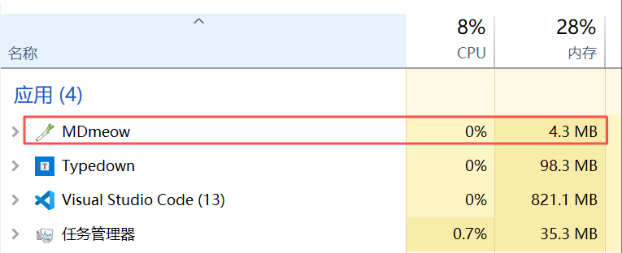

# MDmeow

[简体中文](README.md) · **English** · [日本語](README.ja.md) · [Deutsch](README.de.md)

**Website: [mdmeow.zakee.fun](https://mdmeow.zakee.fun/en.html)**

A lightweight, fast and polished WYSIWYG Markdown editor. **Open it. Get to work.**

<a href="https://zakee.fun" target="_blank"></a>


MDmeow is a lightweight, fast and polished WYSIWYG Markdown editor built with **Tauri + Milkdown/Crepe**. It keeps Markdown files clean and portable while providing a direct, comfortable editing experience.

The default **Miku Cream** rendering system combines a bright document surface, the `#39C5BB` accent, subtle code colors, KaTeX math, sandboxed HTML / SVG / Canvas widgets, compact tables and a restrained desktop UI. If you publish on Typecho, **we recommend pairing MDmeow with the companion Typecho theme [miku-cream](https://github.com/zakee039/miku-cream)** for consistent visuals and rendering between your local notes and published posts.

**Fast to open, comfortable to read, natural to edit.**

## Highlights

- **WYSIWYG Markdown** for headings, lists, quotes, tasks, tables, links and images, with automatic lossless source protection for unsupported fragments (such as YAML frontmatter).
- **Sandboxed HTML / SVG / Canvas web widgets**:
  - Static rich HTML cards, inline `<svg>` diagrams and complex `rowspan`/`colspan` HTML `<table>` blocks render automatically inside a zero-script, nonce-locked sandbox with auto-sizing height.
  - Scripted interactive widgets (such as sliders and `<canvas>` drawings) run inside a strictly isolated `<iframe sandbox="allow-scripts">` (no local file or network access) only after per-document approval (`Show` / `Don't show` / `Close document`), with a one-click toggle back to source.
- **Lossless native HTML typography**: allowlisted rendering for `<details>`/`<summary>`, `<div|p align>`, `<center>`, `<a href>`, `<hr>`, `<kbd>`, `<sub>`, `<sup>`, `<mark>`, `<u>`/`<ins>`, `<small>`, `<ruby>`/`<rt>`/`<rp>`, safe `<span style>`/`<font color>`, and hidden `<!-- ... -->` comments.
- **Lossless KaTeX math**: supports both `$…$` / `$$…$$` and `\(...\)` / `\[...\]` in WYSIWYG editing and standalone HTML / PDF export while preserving your original delimiters.
- **Heading anchors and local relative links**: click links in the hover preview card or `Ctrl/Cmd+Click` in the editor to smoothly jump to `#heading` anchors, open relative `.md` files in new MDmeow tabs, or open safe local files (such as `.html` or `.pdf`) in the default system app while blocking executables.
- **Mermaid diagram previews**: lazily renders `mermaid` code blocks into flowcharts, sequence, class, state, pie, Gantt, mindmap and XY charts without mutating the Markdown source.
- **Markdown source view** with line numbers, syntax colors and subtle alternating rows; `Ctrl/Cmd+/` by default.
- **Multiple tabs, session restore & unified in-app dialogs**: consistent Miku Cream rounded modal cards for unsaved changes (`Save` / `Don't save` / `Cancel`), widget prompts and notices.
- **Save / Save As & inline title rename**: familiar desktop behavior (`Ctrl/Cmd+Shift+S` for Save As) and click-to-rename directly in the title bar.
- **HTML / PDF export**: self-contained offline HTML pages and native PDF printing.
- **Image support** for standard Markdown and common HTML `` forms resolved relative to the current document.
- **Code blocks** with syntax highlighting, independent line numbers and copy feedback.
- **Rebindable shortcuts & Windows file associations** selectable by extension.
- **Four UI languages**: 简体中文, English, 日本語 and Deutsch, plus system language detection.

## Quick viewing for other text files

MDmeow can also open common configuration, code and text files such as JSON, YAML, TOML, INI, ENV, HTML, CSS, JavaScript, TypeScript, Python, Rust, logs and TXT.

These files use a lightweight **Code mode** with line numbers, syntax colors, find/replace, save, and optional customizable alternating-row tinting.

It is designed for quick inspection and small edits, not as a replacement for a full IDE.

## Downloads

Official releases cover Windows, Linux and macOS:

```text
Windows
MDmeow-<version>.exe
MDmeow_<version>_x64.msi

Linux x64
MDmeow-<version>-linux-x86_64.AppImage
MDmeow-<version>-linux-x86_64.deb
MDmeow-<version>-linux-x86_64.rpm

Linux ARM64
MDmeow-<version>-linux-aarch64.AppImage
MDmeow-<version>-linux-aarch64.deb
MDmeow-<version>-linux-aarch64.rpm

macOS
MDmeow-<version>-macOS-universal.dmg
```

### Windows

`MDmeow-<version>.exe` is the single-file portable build. `MDmeow_<version>_x64.msi` is the standard MSI installer with Chinese, English, Japanese and German installer languages.

### Linux

AppImage is the simplest option. Debian / Ubuntu users can use `.deb`; Fedora / RHEL users can use `.rpm`.

### macOS

A universal Intel + Apple Silicon `.dmg` is provided. Community builds are currently not Apple Developer ID signed/notarized.

## Markdown, HTML and web widgets

MDmeow keeps standard Markdown first while cleanly rendering common HTML authoring constructs without altering your source on save:

```md


<details>
  <summary>Expand details</summary>
  Supports <mark>highlights</mark>, <kbd>Ctrl</kbd> + <kbd>S</kbd>, and <ruby>詞<rt>word</rt></ruby>.
</details>

<!-- Comments stay hidden in WYSIWYG and intact in source -->
```

- **Images**: titles, alignment, 25%–200% scaling and deletion.
- **Links**: smooth in-document `#anchor` navigation, relative `.md` tab opening, and safe local file opening.
- **Widget security**: scripted HTML / `<canvas>` widgets never execute in the host WebView; they run in an offline, opaque-origin `<iframe sandbox="allow-scripts">` only after explicit per-document confirmation.

## Math

KaTeX renders inline and block equations using either dollar signs or LaTeX parenthesis/bracket delimiters, preserving original delimiters verbatim:

```text
$E = mc^2$    or    \( E = mc^2 \)

$$
\int_a^b f(x)\,dx
$$

\[
\operatorname{softmax}([0,\ln2,\ln3])=\left[\frac16,\frac26,\frac36\right]
\]
```

## Miku Cream & companion Typecho theme

- bright Cream document background and `#39C5BB` accent
- shared semantic code colors between Markdown code blocks and Code mode
- code background matches the document, with configurable `#FAFFFF` alternating rows
- independent fonts and sizes for document and source views
- unified rounded in-app dialogs and crisp editor toolbar icons

> **Recommended for Typecho users: [miku-cream](https://github.com/zakee039/miku-cream)**
>
> If you run a Typecho blog, we recommend pairing MDmeow with the matching [miku-cream](https://github.com/zakee039/miku-cream) theme. Both share the same Miku Cream palette, code block presentation, KaTeX math (`$...$`, `$$...$$`, `\(...\)`, `\[...\]`), and sandboxed interactive HTML / SVG / Canvas widget rendering so notes authored in MDmeow look and work consistently on your blog.

## Files and windows

- drag and drop files
- multiple tabs
- optional full-path display
- optional previous-session restore
- optional window position and size memory
- when memory is disabled, the window opens centered on the primary display at a sensible size
- Windows file associations selectable by extension
- settings save immediately

## Shortcuts

| Action | Default |
| --- | --- |
| New tab | `Ctrl/Cmd+N` |
| Open | `Ctrl/Cmd+O` |
| Save | `Ctrl/Cmd+S` |
| Save As | `Ctrl/Cmd+Shift+S` |
| Close tab | `Ctrl/Cmd+W` |
| Markdown render / source | `Ctrl/Cmd+/` |
| Find | `Ctrl/Cmd+F` |
| Replace | `Ctrl/Cmd+H` |
| New plain paragraph | `Ctrl/Cmd+Enter` |
| Settings | `Ctrl/Cmd+,` |

Application shortcuts can be changed in **Settings → Shortcuts**. New plain paragraph splits at the cursor and moves the remaining text into a new top-level paragraph, without inheriting a list, indentation, heading or math block. In Markdown source, a blank line separates the paragraphs and the new paragraph starts at column one.

Fixed editing shortcuts include `Ctrl/Cmd+B` (bold), `Ctrl/Cmd+I` (italic), `Ctrl/Cmd+E` (inline code), `Ctrl/Cmd+K` (create or edit a link), `Ctrl/Cmd+Alt+X` (strikethrough), `Shift+Enter` (hard line break), and `Ctrl/Cmd+0`–`7` (block conversion). Clipboard, undo and cursor commands are protected from application shortcut overrides. The export button remains available; typing `:shortcode:` still converts the text into an emoji.

## Configuration

Settings are stored in `settings.toml` and saved immediately.

```toml
language = "system"
spellcheck = true
show_path = false
open_last_session = true

code_alternate_rows = true
code_alternate_row_color = "#FAFFFF"
remember_window_position = false

accent = "#39C5BB"
auto_check_updates = true
```

## Lightweight by design



MDmeow is built with **Tauri + Milkdown/Crepe + CodeMirror**. It deliberately avoids turning into a heavyweight all-in-one workspace.

**When you need to work with Markdown, opening MDmeow should be enough.**

## Build

Requirements: Node.js 20+, `pnpm`, Rust stable. Windows also needs Visual C++ Build Tools, Windows SDK and WebView2.

```bash
pnpm install
pnpm build
pnpm tauri dev
```

Local Windows release:

```powershell
pnpm release:windows
```

```bash
pnpm release:linux
pnpm release:macos
```

Pushing a `vX.Y.Z` tag triggers GitHub Actions to build Windows, Linux x64, Linux ARM64 and macOS, verify the artifact set and SHA256 values, and publish one GitHub Release.

## Stack

| Layer | Technology |
| --- | --- |
| Desktop shell | Tauri v2 / Rust |
| WYSIWYG Markdown | Milkdown Crepe / ProseMirror |
| Source / Code mode | CodeMirror |
| Math | KaTeX |
| Diagrams | Mermaid (lazy-loaded) |
| Markdown → HTML | comrak |
| Export syntax highlighting | highlight.js |
| Windows installer | WiX / MSI |

## Support

If MDmeow saves you time, you can support its continued development on Afdian. ☕

<a href="https://ifdian.net/a/zakee/plan" target="_blank"></a>

## Credits

MDmeow is based on **Ali Naderi / Mowl** and remains available under the **MIT License**.

> **Open it. Get to work.**
