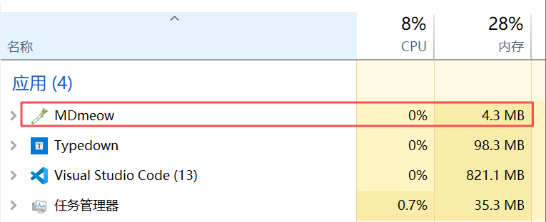

# MDmeow

[简体中文](README.md) · [English](README.en.md) · **日本語** · [Deutsch](README.de.md)

**公式サイト：[mdmeow.zakee.fun](https://mdmeow.zakee.fun)**

軽量・高速で、見た目にも心地よい WYSIWYG Markdown エディター。**開いたら、すぐ仕事。**

<a href="https://zakee.fun" target="_blank"></a>


MDmeow は **Tauri + Milkdown/Crepe** で構築された、軽量・高速・見た目にも心地よい WYSIWYG Markdown エディターです。Markdown 自体の純粋さと移植性を保ちながら、自然で直接的な編集体験を提供します。

既定の **Miku Cream** は、明るい文書背景、`#39C5BB` のアクセント、控えめなコード色、KaTeX 数式、サンドボックス HTML / SVG / Canvas ウィジェット、コンパクトな表と落ち着いたデスクトップ UI を組み合わせています。Typecho ブログをお使いの方には、同じデザイン・描画体系を備えた Typecho テーマ **[miku-cream](https://github.com/zakee039/miku-cream)** の併用をおすすめします。

**すぐ開く。読みやすい。自然に編集できる。**

## 主な機能

- 見出し、リスト、引用、タスク、表、リンク、画像を WYSIWYG で編集（YAML Frontmatter などの特殊構文はソース保護で無損失保持）
- **サンドボックス HTML / SVG / Canvas ウィジェット**：静的 HTML カード、`<svg>` 図、複雑な結合セル HTML `<table>` はスクリプト禁止サンドボックスで自動表示；`<script>` を含むインタラクティブ要素や `<canvas>` はドキュメントごとに確認ダイアログで許可後、オフライン分離サンドボックス内で安全に実行
- **安全なネイティブ HTML 描画**：`<details>` / `<summary>`、`<div|p align>` / `<center>`、`<a href>`、`<hr>`、`<kbd>`、`<sub>`、`<sup>`、`<mark>`、`<u>` / `<ins>`、`<small>`、`<ruby>` ルビ、安全な `<span style>` / `<font color>`、非表示の `<!-- ... -->` コメントを無損失サポート
- **KaTeX 数式**：`$…$` / `$$…$$` と `\(...\)` / `\[...\]` の両方を WYSIWYG 編集および HTML / PDF エクスポートで元の区切り文字のまま無損失表示
- **文書内アンカーとローカル相対リンク**：リンクプレビューのクリックまたは `Ctrl/Cmd+クリック` で `#見出し` へスムーズ移動、相対 `.md` を新規タブで開く、`.html` や PDF などの安全なローカルファイルを既定アプリで開く（実行ファイルはブロック）
- `mermaid` コードブロックからフローチャートなどの図を遅延ロードでプレビュー表示（Markdown ソースはそのまま保持）
- 行番号・シンタックスカラー・交互行表示付き Markdown ソースビュー
- 複数タブ・セッション復元、および統一された Miku Cream スタイルのアプリ内ダイアログ
- 保存 / 名前を付けて保存、タイトル部からのファイル名変更、HTML / PDF エクスポート
- コードブロックのシンタックスハイライト、行番号、コピー、ショートカット再設定、Windows 拡張子別ファイル関連付け
- 简体中文 / English / 日本語 / Deutsch の 4 言語

## ほかのテキストファイルも手軽に確認

JSON、YAML、TOML、INI、ENV、HTML、CSS、JavaScript、TypeScript、Python、Rust、ログ、TXT なども直接開けます。

これらは軽量な **Code モード**で表示され、行番号、シンタックスカラー、検索 / 置換、保存、カスタマイズ可能な交互行背景を利用できます。

本格的な IDE の代替ではなく、素早い確認と軽い修正のための機能です。

## ダウンロード

```text
Windows
MDmeow-<version>.exe
MDmeow_<version>_x64.msi

Linux x64 / ARM64
AppImage / deb / rpm

macOS
MDmeow-<version>-macOS-universal.dmg
```

Windows ではポータブル EXE と MSI インストーラーを提供します。Linux は AppImage / deb / rpm、macOS は Intel + Apple Silicon の universal DMG を提供します。

## Markdown・HTML・数式

標準 Markdown を優先しつつ、HTML ``、`<details>`、`<ruby>`、`<kbd>`、静的 `<svg>`、およびサンドボックス化されたインタラクティブ HTML / `<canvas>` ウィジェットを元のソースを損なわずに描画します。画像はタイトル、配置、25%～200% の拡大縮小、削除に対応します。

KaTeX で `$…$` / `$$…$$` および `\(...\)` / `\[...\]` の行内・ブロック数式を表示します。

```text
$E = mc^2$    /    \( E = mc^2 \)

$$
\int_a^b f(x)\,dx
$$

\[
\operatorname{softmax}([0,\ln2,\ln3])=\left[\frac16,\frac26,\frac36\right]
\]
```

## Miku Cream と Typecho 連携テーマ

- 明るい Cream 背景と `#39C5BB` アクセント
- Markdown コードブロックと Code モードで共通の意味色、交互行の既定色は `#FAFFFF`
- 文書 / ソースのフォントとサイズを個別設定
- 統一された角丸アプリ内ダイアログと視認性の高いテーブル・ツールバーアイコン

> **Typecho ユーザーにおすすめ：[miku-cream](https://github.com/zakee039/miku-cream)**
>
> Typecho でブログを運営している場合、同じデザイン・描画体系を持つ Typecho テーマ **[miku-cream](https://github.com/zakee039/miku-cream)** の同時利用をおすすめします。配色、コードブロック、KaTeX 数式（`$...$` / `$$...$$` / `\(...\)` / `\[...\]`）、サンドボックス HTML / SVG / Canvas ウィジェットまで一貫しており、MDmeow で書いたノートをそのままの見た目で公開できます。

## ファイルとウィンドウ

- ドラッグ＆ドロップ
- 複数タブ
- フルパス表示を選択可能
- 前回セッションを復元可能
- ウィンドウ位置とサイズを記憶するか選択可能
- 記憶しない場合は主画面中央に適切なサイズで起動
- Windows のファイル関連付けを拡張子ごとに選択
- 設定は即時保存

## 主なショートカット

| 操作 | 既定 |
| --- | --- |
| 新しいタブ | `Ctrl/Cmd+N` |
| 開く | `Ctrl/Cmd+O` |
| 保存 | `Ctrl/Cmd+S` |
| 名前を付けて保存 | `Ctrl/Cmd+Shift+S` |
| タブを閉じる | `Ctrl/Cmd+W` |
| Markdown 表示 / ソース | `Ctrl/Cmd+/` |
| 検索 | `Ctrl/Cmd+F` |
| 置換 | `Ctrl/Cmd+H` |
| 新しい通常の段落 | `Ctrl/Cmd+Enter` |
| 設定 | `Ctrl/Cmd+,` |

アプリのショートカットは **設定 → ショートカット** で変更できます。「新しい通常の段落」はカーソル位置で内容を分割し、後半を最上位の通常の段落へ移動します。リスト、インデント、見出し、数式ブロックは引き継ぎません。Markdown ソースでは空行で区切り、新しい段落は行頭から始まります。

固定の編集キーには `Ctrl/Cmd+B`（太字）、`Ctrl/Cmd+I`（斜体）、`Ctrl/Cmd+E`（インラインコード）、`Ctrl/Cmd+K`（リンクの作成・編集）、`Ctrl/Cmd+Alt+X`（取り消し線）、`Shift+Enter`（段落内の改行）、`Ctrl/Cmd+0`–`7`（ブロック変換）があります。コピー、貼り付け、元に戻す、カーソル移動などのキーはアプリのショートカットで上書きできません。エクスポートボタンはそのまま利用でき、`:shortcode:` の入力による Emoji への自動変換も引き続き使用できます。

## 軽量であることも機能



MDmeow は **Tauri + Milkdown/Crepe + CodeMirror** で構築されています。重いオールインワン環境になることを目指していません。

**Markdown を扱いたいとき、MDmeow を開けばすぐ始められる。**

## ビルド

Node.js 20+、`pnpm`、Rust stable が必要です。

```bash
pnpm install
pnpm build
pnpm tauri dev
```

```powershell
pnpm release:windows
```

```bash
pnpm release:linux
pnpm release:macos
```

`vX.Y.Z` タグを push すると、GitHub Actions が Windows、Linux x64 / ARM64、macOS を自動ビルドし、1 つの Release として公開します。

## サポート

MDmeow が役に立ったら、愛発電（Afdian）から開発を応援していただけます。☕

<a href="https://ifdian.net/a/zakee/plan" target="_blank"></a>

## クレジット

MDmeow は **Ali Naderi / Mowl** をベースにし、**MIT License** で公開されています。

> **開いたら、すぐ仕事。**
