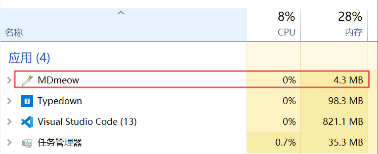

# MDmeow

**简体中文** · [English](README.en.md) · [日本語](README.ja.md) · [Deutsch](README.de.md)

**官网：[mdmeow.zakee.fun](https://mdmeow.zakee.fun)**

一个轻量、快速、精美的 WYSIWYG Markdown 编辑器。**打开即工作。**

<a href="https://zakee.fun" target="_blank"></a>


MDmeow 是一款轻量、快速、精美的 WYSIWYG Markdown 编辑器，基于 **Tauri + Milkdown/Crepe** 构建。它尽量保持 Markdown 文件本身的纯净与可迁移性，同时提供自然、直接的即时排版体验。

当前采用 **Miku Cream** 渲染体系：亮色文档背景、`#39C5BB` 初音青强调色、浅色代码高亮、KaTeX 数学公式、沙盒 HTML / SVG / Canvas 小组件、紧凑表格与克制的桌面端界面。如果你也在使用 Typecho 写博客，**推荐同步搭配同款视觉与渲染体系的 Typecho 主题 [miku-cream](https://github.com/zakee039/miku-cream)**，实现本地笔记与线上文章的一致体验。

**打开快、阅读舒服、编辑自然。**

## 主要特性

- **所见即所得 Markdown**：标题、列表、引用、任务列表、表格、链接、图片等常见语法可直接阅读和编辑，并对无法无损往返的局部语法（如 YAML Frontmatter）自动启用源码保护，绝不破坏原文。
- **沙盒 HTML / SVG / Canvas 网页小组件**：
  - 纯静态富样式 HTML 卡片、原生 `<svg>` 图示与复杂合并单元格 HTML `<table>` 自动在零脚本 `nonce` 沙盒中渲染并自适应高度，不打断阅读；
  - 带 `<script>` 或交互事件的网页小组件（如交互滑块、`<canvas>` 绘图等）在严格受限沙盒（无本地文件访问、无外网访问）中按文档弹窗确认（`显示` / `不显示` / `关闭文档`）后运行，支持随时一键切回源码。
- **常用原生 HTML 排版无损渲染**：安全白名单渲染 `<details>` / `<summary>` 折叠块、`<div|p align>` / `<center>` 对齐、`<a href>`、`<hr>`、`<kbd>`、`<sub>`、`<sup>`、`<mark>`、`<u>` / `<ins>`、`<small>`、`<ruby>` / `<rt>` / `<rp>` 注音、安全样式 `<span style>` / `<font color>`，并自动隐藏 `<!-- ... -->` 注释，保存时完整保留原始 HTML。
- **无损 KaTeX 数学公式**：同时支持行内 `$…$`、`\(...\)` 与块级 `$$…$$`、`\[...\]`，编辑与 HTML / PDF 导出均完整保留原始定界符。
- **文内锚点与本地相对链接**：在悬浮链接卡片内直接点击，或在正文中 `Ctrl/Cmd+点击`，支持平滑跳转并高亮文内 `#标题锚点`、直接在新标签页打开相对 `.md` 文档，以及用系统默认应用打开安全的本地文件（如 `.html`、PDF、图片等，自动拦截可执行文件）。
- **Mermaid 图表预览**：在所见即所得模式下，将 `mermaid` 代码块懒加载渲染为流程图、时序图、类图、状态图、饼图、甘特图、思维导图等图表，保留原始 Markdown 源码。
- **Markdown 源码视图**：一键切换原始 Markdown，带独立行号、语法高亮和轻量隔行着色；默认快捷键 `Ctrl/Cmd+/`。
- **多标签页与统一弹窗体验**：支持多标签页与会话恢复；未保存关闭（`保存` / `不保存` / `取消`）、退出确认、小组件提示等全部采用统一的 Miku Cream 圆角内嵌弹窗。
- **保存 / 另存为与标题栏重命名**：保留传统桌面编辑器的直觉操作，另存为默认快捷键 `Ctrl/Cmd+Shift+S`；点击标题栏文件名即可原地重命名。
- **HTML / PDF 导出**：HTML 导出为离线独立页面（内嵌 KaTeX、highlight.js 与本地图片），PDF 通过系统打印流程输出。
- **图片兼容**：支持标准 Markdown 图片和常见 HTML ``，相对路径以当前 Markdown 文件为基准解析。
- **代码块体验**：语法高亮、独立行号、复制反馈与轻量隔行着色。
- **可配置快捷键与 Windows 文件关联**：设置页可直接录入新组合键，并按后缀选择由 MDmeow 打开的文件类型。
- **四种界面语言**：简体中文、English、日本語、Deutsch，也可以跟随系统语言。

## 顺手查看其它文本文件

除了 Markdown，MDmeow 也可以直接打开常见配置、代码和文本文件，例如 JSON、YAML、TOML、INI、ENV、HTML、CSS、JavaScript、TypeScript、Python、Rust、日志与 TXT。

这些文件会进入轻量的 **Code 模式**，提供行号、语法颜色、查找 / 替换、保存，以及可关闭、可自定义颜色的隔行着色。

它适合快速查看和轻量修改，不试图替代专业 IDE。

## 下载与运行

正式 Release 覆盖 Windows、Linux 和 macOS：

```text
Windows
MDmeow-<版本>.exe
MDmeow_<版本>_x64.msi

Linux x64
MDmeow-<版本>-linux-x86_64.AppImage
MDmeow-<版本>-linux-x86_64.deb
MDmeow-<版本>-linux-x86_64.rpm

Linux ARM64
MDmeow-<版本>-linux-aarch64.AppImage
MDmeow-<版本>-linux-aarch64.deb
MDmeow-<版本>-linux-aarch64.rpm

macOS
MDmeow-<版本>-macOS-universal.dmg
```

### Windows

`MDmeow-<版本>.exe` 是单文件便携版；`MDmeow_<版本>_x64.msi` 是标准 MSI 安装版，并内置简体中文、English、日本語、Deutsch 四种安装语言。

安装版与便携版维护统一的文件关联逻辑，安装版优先，便携版在没有有效安装版时兜底。

### Linux

推荐优先使用 AppImage；Debian / Ubuntu 可使用 `.deb`，Fedora / RHEL 系可使用 `.rpm`。

### macOS

提供 Intel + Apple Silicon 通用 `.dmg`。当前社区构建未做 Apple Developer ID 签名 / 公证，如 Gatekeeper 阻止首次启动，可在 Finder 中右键应用并选择“打开”。

## Markdown、HTML 与网页小组件

MDmeow 优先保持标准 Markdown，同时兼顾笔记和博客里常见的 HTML 写法，所有源码在编辑与保存过程中无损保留：

```md


<details>
  <summary>点击展开说明</summary>
  这里可以放补充内容，支持 <mark>高亮</mark>、<kbd>Ctrl</kbd> + <kbd>S</kbd> 与 <ruby>词向量<rt>embedding</rt></ruby>。
</details>

<!-- 隐藏注释在 WYSIWYG 模式下不显示，但会完整保留在源码中 -->
```

- **图片**：支持标题、左 / 中 / 右对齐、25% ～ 200% 缩放与删除。
- **链接跳转**：支持 `#标题锚点` 平滑跳转、相对 `.md` 标签页内打开，以及 `.html` / PDF 等安全本地文件用系统默认程序打开。
- **网页小组件安全模型**：带内嵌 `<script>` 或交互事件的 HTML / `<canvas>` 小组件绝不会在主窗口中执行，而是隔离在无同源权限、禁外网的 `<iframe sandbox="allow-scripts">` 中，且按文档征得你的明确同意后才渲染。

## 数学公式

使用 KaTeX 无损渲染行内与块级数学公式，同时兼容美元符和 LaTeX 括号定界符：

```text
$E = mc^2$    或    \( E = mc^2 \)

$$
\int_a^b f(x)\,dx
$$

\[
\operatorname{softmax}([0,\ln2,\ln3])=\left[\frac16,\frac26,\frac36\right]
\]
```

无论是编辑器内实时预览、修改保存还是导出独立 HTML / PDF，都会保持你原本书写的定界符格式。

## Miku Cream 与 Typecho 配套主题

MDmeow 默认使用 **Miku Cream** 视觉体系：

- 亮色 Cream 文档背景与 `#39C5BB` 主强调色
- Markdown 代码块与 Code 模式共享语义配色，代码背景与文档背景统一
- 代码隔行默认使用极浅的 `#FAFFFF`，可在设置中修改
- 正文与源码字体、字号可以独立设置
- 统一的圆角内嵌弹窗与清晰的表格 / 悬浮工具栏图标

> **Typecho 博客推荐同步使用：[miku-cream](https://github.com/zakee039/miku-cream)**
>
> 如果你使用 Typecho 搭建个人博客，推荐同步搭配同系列的 [miku-cream](https://github.com/zakee039/miku-cream) 主题。两者共享同一套 Miku Cream 配色、代码块、KaTeX 公式（含 `$...$`、`$$...$$`、`\(...\)`、`\[...\]`）以及受限沙盒 HTML / SVG / Canvas 交互小组件渲染逻辑，让你在 MDmeow 里写完的笔记直接发布到 Typecho 也能保持高度一致的观感与交互体验。

目标不是让界面显得“功能很多”，而是让内容本身更舒服。

## 文件与窗口

- 拖拽文件直接打开
- 多标签页
- 可显示完整文件路径
- 可恢复上一次会话
- 可选择是否记住窗口位置与大小
- 不记住位置时，以合适尺寸在主屏中央启动
- Windows 文件关联可按后缀选择
- 设置修改即时保存

没有必须建立的项目，也没有启动前的复杂配置流程。

## 常用快捷键

| 操作 | 默认快捷键 |
| --- | --- |
| 新建标签页 | `Ctrl/Cmd+N` |
| 打开 | `Ctrl/Cmd+O` |
| 保存 | `Ctrl/Cmd+S` |
| 另存为 | `Ctrl/Cmd+Shift+S` |
| 关闭标签页 | `Ctrl/Cmd+W` |
| Markdown 渲染 / 源码 | `Ctrl/Cmd+/` |
| 查找 | `Ctrl/Cmd+F` |
| 替换 | `Ctrl/Cmd+H` |
| 新建普通段落 | `Ctrl/Cmd+Enter` |
| 设置 | `Ctrl/Cmd+,` |

应用级快捷键可以在 **设置 → 快捷键** 中重新绑定。

“新建普通段落”在光标处拆开当前内容，将后半段放入新的顶层普通段落，不继承列表、缩进、标题或公式块；Markdown 源码中以空行分隔，新段落顶格开始。

固定编辑快捷键包括 `Ctrl/Cmd+B` 加粗、`Ctrl/Cmd+I` 斜体、`Ctrl/Cmd+E` 行内代码、`Ctrl/Cmd+K` 创建或编辑链接、`Ctrl/Cmd+Alt+X` 删除线、`Shift+Enter` 段内换行，以及 `Ctrl/Cmd+0`–`7` 块转换。复制、粘贴、撤销、光标移动等编辑按键受到保护，不能被应用快捷键覆盖。导出按钮保留，Emoji 仍可输入 `:shortcode:` 自动转换。

## 配置

`settings.toml` 支持即时保存。常见配置：

```toml
language = "system"
spellcheck = true
show_path = false
open_last_session = true

editor_font = ""
editor_font_size = 16
source_font = ""
source_font_size = 15

code_alternate_rows = true
code_alternate_row_color = "#FAFFFF"
remember_window_position = false

accent = "#39C5BB"

proxy_enabled = false
proxy_url = ""
auto_check_updates = true
```

## 轻快，不只是口号



> 实际资源占用会随文档内容、WebView2 和系统环境变化。

MDmeow 基于 **Tauri + Milkdown/Crepe + CodeMirror**。它不会为了覆盖所有场景而不断变成一个更重的软件。

**需要处理 Markdown 的时候，打开 MDmeow 就够了。**

## 构建

环境要求：

- Node.js 20+
- `pnpm`
- Rust stable
- Windows：Visual C++ Build Tools、Windows SDK、WebView2

开发：

```bash
pnpm install
pnpm build
pnpm tauri dev
```

本地 Windows 正式构建：

```powershell
pnpm release:windows
```

Linux / macOS：

```bash
pnpm release:linux
pnpm release:macos
```

推送 `vX.Y.Z` tag 后，GitHub Actions 会自动构建 Windows、Linux x64、Linux ARM64 和 macOS 全平台产物，校验文件集合与 SHA256，并发布同一个 GitHub Release。

## 技术栈

| 层 | 技术 |
| --- | --- |
| 桌面壳 | Tauri v2 / Rust |
| WYSIWYG Markdown | Milkdown Crepe / ProseMirror |
| 源码 / Code 模式 | CodeMirror |
| 数学公式 | KaTeX |
| 图表预览 | Mermaid（按需懒加载） |
| Markdown → HTML | comrak |
| 导出语法高亮 | highlight.js |
| Windows 安装器 | WiX / MSI |

## 支持

如果 MDmeow 为你节省了时间，欢迎通过爱发电支持它的持续开发。☕

<a href="https://ifdian.net/a/zakee/plan" target="_blank"></a>

## 致谢与许可

MDmeow 基于 **Ali Naderi / Mowl** 二次开发，继续以 **MIT License** 发布。

感谢上游项目提供了一个简洁而优雅的 Markdown 编辑器基础。

> **打开即工作。**
